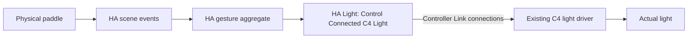

# Use HA Light to connect a physical HA switch to a Control4 light

This setup uses the physical switch as a button controller. Its relay does not
switch the smart bulb's supply. Control4's existing light driver controls the
actual light, using its own load commands and capabilities.

The target C4 light or group does not need to be exported to HA. Only the wall
switch's reported gestures travel through HA. A compatible C4 target implements
raise/lower/stop when its Button Links receive hold/release. Availability of
compatible links and actual dimming behavior must be checked in Composer.

## Configure the physical switch in Home Assistant

Use the manufacturer's relay-decoupling or smart-bulb setting. Enable scene
reporting, including single taps, held and released events where supported.
These are device settings, independent of this C4 driver's Operation Mode.
The driver does not change them automatically during an update or discovery.

For the test ZEN76, Zooz documents:

- **Relay Control / Smart Bulb Mode, parameter 12:** value **2** disables both
  paddle and Z-Wave on/off control of the relay, leaving scene reporting
  available. Value **0** disables the paddle only and still permits remote
  relay commands. For a smart bulb whose supply must stay on, prefer disabling
  both control paths and verify the bulb still has power after setup.
- **Scene Control, parameter 10:** value **1** enables scene reporting.
- **Scene Control Multi-Tap, parameter 19:** value **0** retains multi-tap,
  held and released reports. Disabling this setting removes those reports.
- Review the device's power-restoration setting separately if the smart bulb
  must receive power after an outage. Smart-bulb mode and the C4 load driver's
  state are different settings.

Use the options presented for the actual device/firmware in HA and check
[Zooz's ZEN76 settings](https://www.support.getzooz.com/kb/article/549-zen76-s2-on-off-switch-advanced-settings/).
Other Zooz models, Zigbee switches and other manufacturers can use different
parameters or labels. Do not apply the ZEN76's parameter numbers to them.

## Configure the HA gesture source

The optional HA companion aggregates the upper and lower paddle sources into
one control. Keep its existing unique ID when expanding a previously installed
control, so its aggregate Entity ID and saved C4 gesture IDs remain stable.
Map actual reported actions; do not invent an initial Button Pushed event from
a completed tap. Use the multi-button configuration example in
[development.md](development.md).

## Connect the existing light in Composer

1. Keep the existing C4 light/dimmer instance, its driver and its programming.
   Its own load control remains enabled; it controls the actual target light.
2. Add HA Light as a separate device, or update the existing HA Light in
   place. Keep any installed HA Switch and its existing programming intact.
   Preserve Light's Device Link to HA Coordinator. Choose the configured
   gesture aggregate using **Actions > Select Device**, then set **Operation
   Mode = Control Connected C4 Light**.
3. In **Connections**, select HA Light's **Top Controller Link** under
   **Control Inputs** and connect it to the target light/group's on/ramp-up
   Button Link output. Connect **Bottom Controller Link** to its off/ramp-down
   output. Use **Toggle Controller Link** only for an actual toggle-button
   source. For Light Group, the targets are **On Button Link** (300), **Off
   Button Link** (302) and **Toggle Button Link** (301), respectively.
4. A reported single top/bottom tap sends the standard logical Button Link
   push/click sequence. A reported hold sends push once and a subsequent
   reported release sends release. The target light driver decides how to
   implement On, Off, ramping and stop. Hold support requires the source to
   declare release and the target driver to implement hold/stop behavior.
5. Double/triple taps continue to fire their existing C4 programming events.
   They do not also act as repeated single-click load commands. Avoid adding
   duplicate On/Off programming to single taps when Button Links already
   perform that operation.

In HA Light's Control Connected C4 Light mode, every HA load-control command is blocked,
including the original Turn On/Turn Off commands and incoming button/relay
commands. The original connection identities and commands remain present for
existing installations; Direct and Gesture Bridge retain their original roles.
The original Top/Bottom/Toggle **Button Link** outputs (200–202) let another
keypad/controller operate this driver's own load. They remain unchanged; use
the new consumer-side **Controller Link** inputs (203–205) for this route. The
target's output provides lighting control; the HA Light's input consumes it
and sends commands upstream. No group-driver changes are needed to add that
connection. This new connection set applies only to HA Light, not HA Switch.
Use the connected light's own commands, conditionals and loops for load state
and brightness. The wall controller's mode does not infer the target light's
state from the physical switch's relay.

This path depends on live HA and C4 communication. Initial snapshots, reloads
and reconnects do not replay old presses or start a hold. If a previously
forwarded hold loses its source/session, the driver releases that logical C4
hold to stop the connected target; this cleanup is not a physical release
event and does not fire gesture programming.

## Qualification

Local tests cover contract delivery, mode isolation and Button Link messages.
Binding compatibility, actual On/Off, hold-to-dim/stop, repeated taps and
reconnect behavior still need verification with the chosen C4 light driver.
The assistant has not changed the ZEN76 relay/scene settings or the existing
light's configuration automatically.

Test the direct C4 path first when the target already exists in C4: single taps,
short and long holds in both directions, release while dimming, repeated holds,
and source/transport loss during a hold. Record start/stop responsiveness and
confirmed target brightness. The HA representation of Jeff's Office Light
Group (`light.light_group_jeff_s_office`, Control4 platform, unique ID `2425`)
is optional for this path; its brightness/transition attributes alone do not
prove that the C4 group's Button Links implement hold and stop.

For an HA-controlled target, test DeviceSide's existing raise/lower/stop actions
on a supported target before optimizing the path. Gesture Bridge does not
implement its own dimming loop. Compare observed execution and feedback before
deciding whether additional integration work is needed.
